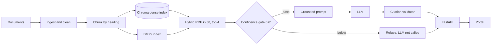

# Ops Copilot

Ops Copilot answers questions about Meridian Supply Co.'s (fictional) warehouse and procurement SOPs, with citations, and refuses when the documents do not cover the question. Stack: Python 3.12, LangChain, Chroma, BM25, Ollama (or Groq), FastAPI, uv.

## Status

**Phase 1: working prototype, eval bars not all met.** The 15-question eval passes 3 of 5 KPIs and **fails 2**: faithfulness (0.632 vs 0.90) and p95 latency (15.9 s vs 8 s). Retrieval and refusal are solid; answer quality on multi-document and ambiguous questions is not. Nothing was loosened to pass. Details: [eval/report.md](eval/report.md).

## Setup

```bash
uv sync
ollama pull nomic-embed-text
ollama pull llama3.1:8b
cp .env.example .env    # then set LLM_PROVIDER=ollama and OLLAMA_MODEL=llama3.1:8b
```

Set `GROQ_API_KEY=` in `.env` only if you use `LLM_PROVIDER=groq`. Never commit `.env` (it is git-ignored).

## Run the portal

```bash
uv run python -m ops_copilot
```

Then open http://localhost:8000 (or `make run`). Needs Ollama running locally. Docker: see [deploy/README.md](deploy/README.md).

## Notebook, eval, tests

```bash
make notebook                                   # executes notebooks/01_rag_walkthrough.ipynb (needs Ollama)
uv run python eval/run_eval.py                  # 15-question eval -> eval/latest.json
uv run python eval/calibrate.py                 # gate-threshold calibration on the held-out set
uv run pytest -q                                # offline tests
for g in scripts/gate_*.sh; do bash "$g"; done  # all gates (lint, typecheck, tests, secrets)
```

## Architecture



## Security notes

- **No authentication.** The API and portal are open to whoever can reach them.
- **Localhost only by default**: the server binds 127.0.0.1. Binding elsewhere requires `OPS_COPILOT_ALLOW_NONLOCAL=1`, and the API checks the `Host` and `Origin` headers against `OPS_COPILOT_ALLOWED_HOSTS` and requires a JSON content type. The Docker setup publishes only `127.0.0.1:8000`.
- **Plain-text rendering**: the portal renders model output as text, never HTML.
- **Citations are validated**: every `[DOC §section]` must match a retrieved chunk, otherwise the answer is replaced by a refusal.
- No secrets in the repo; `.env` is git-ignored and excluded from the Docker build context.

## Latest eval

Run 2026-11-20, `llama3.1:8b` (generator and judge), `nomic-embed-text`, hybrid top-4, gate 0.61. Source: `eval/latest.json`; full report with per-question results and failure analysis: [eval/report.md](eval/report.md).

| KPI | Result | Bar | Status |
|---|---|---|---|
| Faithfulness | 0.632 | >= 0.90 | **FAIL** |
| hit@4 | 1.000 | >= 0.85 | PASS |
| MRR | 1.000 | >= 0.70 | PASS |
| Refusal correct | 2/2 | 2/2 | PASS |
| p95 latency | 15,877 ms | < 8,000 ms | **FAIL** |

Questions passed: 7 of 15.

## Known limitations

- **Same-model judge**: the faithfulness judge is the same 8B model as the generator and showed both a false negative and a false positive. Treat faithfulness as a smoke signal.
- **8B latency**: a local 8B model takes 4 to 16 s per answered question; multi-document questions set the p95.
- **Validator false refusals**: the citation validator can refuse a correct answer, for example when it mentions a token like `PO-2291` or `COVID-19`, uses a citation form outside the grammar (ranges, "Section n"), uses non-ASCII symbols, or cites a section that was not retrieved. The full list is in [eval/report.md](eval/report.md).
- Multi-document and ambiguous questions are often answered incompletely; the gate threshold margin is thin (one unanswerable question cannot be separated from the answerable ones).
- Single eval run; local Ollama at temperature 0 is not guaranteed deterministic.
