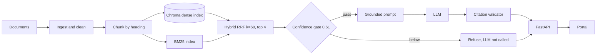

# Ops Copilot

Ops Copilot answers questions about Meridian Supply Co.'s (fictional) warehouse and procurement SOPs, with citations, and refuses when the documents do not cover the question. Stack: Python 3.12, LangChain, Chroma, BM25, Ollama (or Groq), FastAPI, uv.

## Status

**Phase 1: working prototype, eval bars not all met.** Iteration 2 of the official 15-question eval (2026-11-20, code `00d4363`, Groq `openai/gpt-oss-120b` as generator and judge) passes 4 of 5 KPIs and **fails 1**: faithfulness (0.867 vs 0.90, FAIL). Retrieval (hit@4 1.0, MRR 1.0), refusal (2/2) and p95 latency (1.79 s vs 8 s) pass; 11 of 15 questions pass; two multi-document questions (Q10, Q11) were falsely refused by the citation validator. The Iteration 1 baseline (local `llama3.1:8b`, code `6e2718f`: faithfulness 0.381, p95 13.8 s, 7 of 15 passed) is kept in the report with a before/after comparison. The latency pass is not a like-for-like pipeline improvement (remote API vs local hardware). Nothing was loosened to pass. Details: [eval/report.md](eval/report.md).

## Setup

```bash
uv sync
ollama pull nomic-embed-text
ollama pull llama3.1:8b
cp .env.example .env    # then set LLM_PROVIDER=ollama and OLLAMA_MODEL=llama3.1:8b
```

Set `GROQ_API_KEY=` in `.env` only if you use `LLM_PROVIDER=groq`. Never commit `.env` (it is git-ignored).

With Docker (from the repository root; `--env-file .env` is required because compose's project directory is `deploy/`, so otherwise it reads `deploy/.env` and falls back to the defaults):

```bash
docker compose --env-file .env -f deploy/docker-compose.yml up -d
docker compose -f deploy/docker-compose.yml exec ollama ollama pull nomic-embed-text
docker compose -f deploy/docker-compose.yml exec ollama ollama pull llama3.1:8b
```

## Run the portal

```bash
uv run python -m ops_copilot
```

Then open http://localhost:8000 (or `make run`). Needs Ollama running locally. Docker: see [deploy/README.md](deploy/README.md).

## Notebook, eval, tests

```bash
make notebook                                   # executes notebooks/01_rag_walkthrough.ipynb (needs Ollama)
uv run python eval/run_eval.py                  # 15-question eval -> eval/latest.json (see judge rules below)
uv run python eval/calibrate.py                 # gate-threshold calibration on the held-out set
uv run pytest -q                                # offline tests
for g in scripts/gate_*.sh; do bash "$g"; done  # all gates (lint, typecheck, tests, secrets)
```

The eval sends corpus text to the LLM, so it refuses to run unless the provider is local Ollama on a loopback host. To run it against a remote provider (for example `LLM_PROVIDER=groq`) or a non-loopback Ollama, set `EVAL_ALLOW_REMOTE=1` deliberately on the command line or in the shell. It is read only from the real process environment; a value in `.env` is ignored.

The eval loads `.env` the same way the app does. The judge defaults to the generator model; set `EVAL_JUDGE_MODEL` to use another. It refuses to run (exit 2) if the judge is any 8B model, is smaller than the generator, or a model size cannot be parsed from its name, so the small local `llama3.1:8b` is no longer accepted as generator or judge and Iteration 1 cannot be re-run as configured. `EVAL_PACE_S` (seconds, default 0) adds an untimed sleep before every generator and judge call; a 429 from either is retried after an untimed backoff (10, 20, 40, 60, 60 s). Iteration 2 was run with `EVAL_PACE_S=10`. Example: `LLM_PROVIDER=groq GROQ_MODEL=openai/gpt-oss-120b EVAL_ALLOW_REMOTE=1 EVAL_PACE_S=10 uv run python eval/run_eval.py`. It prints `generator model='...' judge model='...'` (names only, quoted with repr, never the key). Note that `EVAL_ALLOW_REMOTE=1` sends the corpus and questions to the remote provider.

## Architecture



## Security notes

- **No authentication.** The API and portal are open to whoever can reach them.
- **Localhost only by default**: the server binds 127.0.0.1. Binding elsewhere requires `OPS_COPILOT_ALLOW_NONLOCAL=1`, and the API checks the `Host` and `Origin` headers against `OPS_COPILOT_ALLOWED_HOSTS` and requires a JSON content type. The Docker setup publishes only `127.0.0.1:8000`.
- **Plain-text rendering**: the portal renders model output as text, never HTML.
- **Citations are validated**: every `[DOC §section]` must match a retrieved chunk, otherwise the answer is replaced by a refusal.
- **Never print resolved secrets**: `docker compose config` and `docker inspect` print `GROQ_API_KEY` in clear text when it is set. Never paste their output into chat, issues or logs.
- No secrets in the repo; `.env` is git-ignored and excluded from the Docker build context.

## Latest eval

Iteration 2: official run 2026-11-20T22:57:27Z on commit `00d4363`, Groq `openai/gpt-oss-120b` (generator and judge, same judge prompt as Iteration 1), `nomic-embed-text`, hybrid top-4, gate 0.61. Source: `eval/latest.json`; full report with the Iteration 1 (baseline) comparison, per-question changes and failure analysis: [eval/report.md](eval/report.md).

| KPI | Iteration 1 (baseline) | Iteration 2 | Bar | Iteration 2 status |
|---|---|---|---|---|
| Faithfulness | 0.381 (8/21 claims) | 0.867 (13/15 claims) | >= 0.90 | **FAIL** |
| hit@4 | 1.000 | 1.000 | >= 0.85 | PASS |
| MRR | 1.000 | 1.000 | >= 0.70 | PASS |
| Refusal correct | 2/2 | 2/2 | 2/2 | PASS |
| p95 latency | 13,808.5 ms | 1,790.5 ms | < 8,000 ms | PASS |

Questions passed: 11 of 15 (Iteration 1: 7). Also: citation accuracy 0.909 (0.917), answer rate 0.846 (0.923), false refusals 2 (1): Q10 `invalid_citation` and Q11 `no_valid_citations`. Q9 (faithfulness 0.5) and Q13 (answered with one reading only) also fail. Iteration 1 is the local `llama3.1:8b` run (code `6e2718f`). The two iterations differ in model, judge and hardware, so they show the effect of the configuration, not of a pipeline change.

## Known limitations

- **Single run per iteration**: the figures above come from one official run per iteration; there is no second run to show the spread. Temperature is 0 but outputs are still nondeterministic (a post-run re-ask of Q11 was answered although the official run refused it; see the report).
- **Same-model judge**: in both iterations the faithfulness judge is the same model as the generator, so it shares the generator's blind spots. In Iteration 1 it gave false negatives on claims that match the corpus word for word (for example Q1, Q3); in Iteration 2 it rejected a supported claim in Q9. Treat faithfulness as a smoke signal.
- **Latency**: Iteration 2 latency (all answered questions under 1.8 s) is dominated by the Groq API and network, not by local hardware, so it is not comparable with the 3 to 14 s of the local 8B Iteration 1. The corpus and questions were sent to Groq with the owner's approval (`EVAL_ALLOW_REMOTE=1`).
- **Validator false refusals**: the citation validator can refuse a correct answer, for example when it mentions a token like `PO-2291` or `COVID-19`, uses a citation form outside the grammar (ranges, "Section n"), uses non-ASCII symbols, or cites a section that was not retrieved. The full list is in [eval/report.md](eval/report.md).
- Multi-document and ambiguous questions are often answered incompletely; the gate threshold margin is thin (one unanswerable question cannot be separated from the answerable ones).
